# Status light

Once Linux has booted and the Sentry USB server starts, the existing activity
LED shows application status. Raspberry Pi firmware boot codes remain unchanged.
**Different colours are for Raspberry Pi 5 only.** Pi 4, Pi Zero 2 W, Pi 3A+
and other supported single-colour boards show **the same blink patterns with
the same meanings** on their activity light. On boards with a separate power
light, that light stays under the Pi's control.

   
  <em>Open the image for a full-size view. The bars show each pattern even with animation disabled.</em>

| Meaning | Pi 5 colour | Pattern |
| --- | --- | --- |
| Starting Sentry USB | Amber | Slow pulse: one second on, one second off |
| Preparing storage / USB offline for maintenance | Amber | Fast pulse: quarter second on, quarter second off |
| Ready, waiting for a host, or USB suspended | Green | One short flash every three seconds |
| Healthy and connected over USB | Green | Two short flashes every three seconds |
| Recent camera-disk writes | Green | Quick pulses: 400 ms on, 100 ms off |
| Needs attention | Red | Mostly lit, with a brief dark dip every three seconds |

The double blink means normal server startup completed, the archive worker is
alive, storage is usable, and the USB host configured the presented drive. It
does not certify BLE, archive/cloud transfers or the contents of recorded video.

The write indication watches **new changes** to the writable camera disk image
while it is connected to the host. It lasts three seconds after the last observed
change, then returns to the double blink. It reports camera-disk write activity,
not a guarantee that every write contains valid footage; host filesystem metadata
and formatting also modify that image. Old timestamps, new observer startup,
image replacement and USB reconnects do not count as new writes. USB maintenance
resets the baseline. This does not alter BLE's separate awake/asleep heuristic.

The activity light no longer shows ordinary microSD activity while Sentry USB
owns it. On Pi 5, application colours also take over the red channel during that
time. On orderly stop its previous triggers are restored; systemd also attempts
restoration after a crash. Kernel panic, power loss and unsupported LED drivers
cannot be diagnosed by a running userspace controller. There is no smooth fading:
the standard onboard GPIO LED driver provides on/off control.

If the light shows a fault, check the web UI and service logs for unavailable
storage, failed startup, a failed archive worker, or an unreadable USB state.
LED control is optional: missing hardware or a write failure cannot stop startup,
archiving or USB presentation. Apply updates through the normal reboot flow so
old archive scripts exit. During an upgrade, the new controller waits for any
legacy archive worker to exit before taking over the LEDs, then takes over
automatically without needing another server restart.

Active USB maintenance is tracked for the entire existing gadget-cycle lock,
including work between disconnect and reconnect. Archive phase changes alone do
not clear recent camera-disk activity while USB remains connected. USB state is
sampled every 500 ms; a physical disconnect and reconnect completed between
samples can be missed. Software-controlled gadget cycles explicitly reset the
write baseline even when they complete between samples.

Native Pi 5 colour/polarity, visible pulse timing, shutdown and actual-car write
indication must be checked on hardware; Linux fixture tests do not establish that
qualification. See [Raspberry Pi's native LED reference](https://www.raspberrypi.com/documentation/computers/configuration.html#led-behaviour)
for boot-failure codes.
